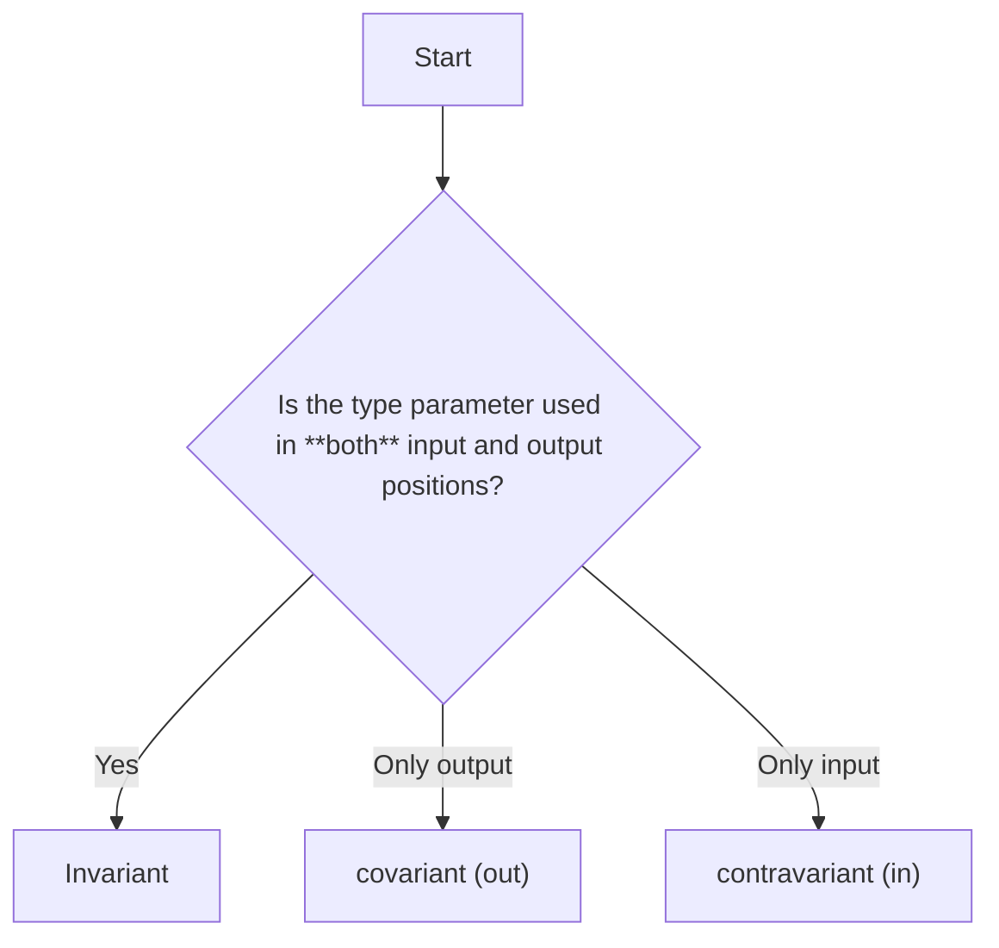

# C# Generics
## References
- Github Copilot
- [Generics in .NET - Microsoft Learn](https://learn.microsoft.com/en-us/dotnet/standard/generics)
- [Generic Constraints in C# - Geeks for Geeks](https://www.geeksforgeeks.org/csharp/generic-constraints-in-c-sharp/)

## Notes
Generics are classes, structures, interfaces, and methods that have placeholders (type parameters) for one or more of the types that they stores or use.
```csharp
public class SimpleGenericClass<T>
{
	public T Field
}

SimpleGenericClass<string> g = new SimpleGenericClass<string>();
```

In this case, the class `SimpleGenericClass` has a generic `Field`. The field will be a `string`. 

A *generic type definition* is a class, structure, or interface declaration that functions as a template, with placeholders
for the types that it can contain or use. Since it is only a template, you cannot create instances of a generic type definition.

*Generic type parameters* are placeholders in a generic type or method definition.

*Constructed type* is the result of specifying types for the generic type parameters of a generic type definition.

*Generic type argument* is any type that is substituted for a generic type parameter.

*Generic type* can refer to both constructed type and generic type definitions.

### Tradeoffs of Generics
#### Advantages
- type safety checks are enforced at compile time rather than by the developer
- reuse of code & less code
- better performance for storing & manipulating value types
- type-safe callbacks without multiple delegate classes
- streamlines dynamically generated code, don't have to generate the type
#### Limitations
- .NET does not support context-bound generic types
- enums cannot have generic type parameters
- lightweight dynamic methods cannot be generic
- a nested type enclosed in a generic type cannot be instantiated unless types have been assigned to all enclosing types

### Generic Constraints
Constraints tell the compiler what a type parameter is, which enables safer APIs.
```csharp
// unconstrained - you can only call object members
void Print<T>(T value) => Console.WriteLine(value?.ToString());

// constrained - compiler knows T has these capabilities
void Process<T>(T item)
	where T : class,
		IComparable<T>,
		new()
{
	var copy = new T();	 // allowed because of new() constraint
	int cmp = item.CompareTo(copy);	// allowed because of IComparable constraint
}
```

T can have the following constraints

| Constraint | Meaning |
| ---- | ---- |
| `where T : struct` | value type, implies non-nullable |
| `where T : class` | reference type |
| `where T : notnull` | non-nullable value or reference type | 
| `where T : unmanaged` | unmanaged value type (no managed refs) |
| `where T : new()` | has parameterless constructor |
| `where T : SomeClass` | inherits from `SomeClass` |
| `where T : ISomeInterface` | implements `ISomeInterface` |
| `wheer T : U` | T is or derives from another type param `U`

There are two common mistakes associated wth generic constraints.
1. Constraints don't propagate automatically - when a constraint is declared on a class, it only applies to the class-level T. Methods
that introduce their own type parameter are completely separate. The constraint must be repeated on the method if the 
type parameter is different than the class's.
	
1. `new()` and `abstract` class conflicts, or using constraints that don't mesh together
```csharp
// MISTAKE: constraints don't propagate automatically
class Repository<T> where T : IEntity
{
	// Error: T is not constrained here, must repeat constraint
	void Save<T>(T entity) {}	// treated as a generic method, no constraint
	void Save(T entity) {}		// uses the class-level constraint
}

// MISTAKE: new() and abstract class conflict, abstract classes have no public parameterless ctor
void Make<T>() where T : AbstractBase, new() { }	// runtime error
```

### Covariance (out)
*Covariance* lets a generic type be used as a **more general** base type. This only applies to interfaces and delegates
and can only be used for types that **produce** values.
```csharp
// IEnumerable<out T> is covariant
IEnumerable<string> strings = new List<string> { "hello" };
IEnumerable<object> objects = strings;		// OK - string is an object

// Defining your own covariant interface
interface IProducer<out T>
{
	T Produce();		// OK - T in output position
	void Consume(T x);	// MISTAKE - T in input position, would not compile
}

class StringProducer : IProducer<string>
{
	public string Produce() => "hello";
}

IProducer<object> p = new StringProducer(); // this is an example of covariance in action
```

### Contravariance (in)
*Contravariance* lets a generic type be used as a **more specific** or derived type. This applies to types that **consume** values.

```csharp
// Action<in T> is contravariant
Action<object> printObject = o => Console.WriteLine(o);
Action<string> printString = printObject;	// OK - can use object handler for string

// Defining your own contravariant interface
interface IConsumer<in T>
{
	void Consume(T value);	// OK - T in input position
	T Produce();			// MISTAKE - T in output position, would not compile
}

class ObjectConsumer : IConsumer<object>
{
	public void Consume(object value) => Console.WriteLine(value);
}

IConsumer<string> c = new ObjectConsumer();	// this is an example of contravariance in action
c.Consume("hello");
```

Some common mistakes for covariance/contravariance are:
1. Trying variance on classes - it only works on interfaces and delegates
1. Variance in both directions - must only be in or out
1. Forgetting IEnumerable is covariant but IList is *invariant* - IEnumerable can be used as a more generic type, but IList would fail

## Generic Design Patterns
### Repository Pattern with Constraints
**Problem**: We have many entity types, each with a separate repository class but identical code.
**Solution**: Generic base to capture shared logic. Uses `where T : IEntity` because we need to know that `T` has an id for `entity.Id` to compile.
Also uses `where T : class` because we are using a dictionary, so we want to store by reference and have `GetValueOrDefault` return `null`.

```csharp
// The contract every entity must fulfill
public interface IEntity
{
	Guid Id { get; }
}

// generic contract - T must be a class implementing IEntity
public interface IRepository<T> where T : class, IEntity
{
	T? GetById(Guid id);
	void Save(T entity);
	IEnumerable<T> GetAll();
}

// generic base - no duplication across entity types
public abstract class InMemoryRepository<T> : IRepository<T>
	where T : class, IEntity
{
	private readonly Dictionary<Guid, T> _store = new();

	public T? GetById(Guid id) => _store.GetValueOrDefault(id);
	public void Save(T entity) => _store[entity.Id] = entity;
	public IEnumerable<T> GetAll() => _store.Values;
}

// Concrete repos just declare their type, no duplicated logic
public class UserRepository : InMemoryRepository<User>
{
	// Add user-specific queries here if needed
	public IEnumerable<User> GetAdmins()
		=> GetAll().Where(u => u.IsAdmin);
}

public class OrderRepository : InMemoryRepository<Order> { }
```

### Strategy Pattern with Generics
**Problem**: Need swappable algorithms without casting to/from object.
**Solution**: Constrained generic interface make the algorithm type-safe for its specific data. `T : IComparable<T>` allows
the sorter to use `a.CompareTo(b)` without knowing the type.

```csharp
// Type-safe strategy - no casting, no object
public interface ISorter<T> where T : IComparable<T>
{
	void Sort(IList<T> items);
}

public class BubbleSorter<T> : ISorter<T> where T : IComparable<T>
{
	public void Sort(IList<T> items)
	{
		for (int i = 0; i < items.Count - 1; i++)
		{
			for (int j = 0; j < items.Count - i - 1; j++)
			{
				if (items[j].CompareTo(items[j+1]) > 0)
					(items[j], items[j+1] = (items[j+1, items[j]);
			}
		}
	}
}
```

### Builder Pattern with Fluent Generics (Curiously Recurring Template Pattern)
**Problem**: Fluent builders break when inherited - base clas methods return the base type.
**Solution**: CRTP - the base class takes its own derived type as a type parameter, and can return the correct concrete type. 
`where TBuilder : QueryBuilder<TBuilder, TEntity>` makes the `(TBuilder)this` return safe.

```csharp
// Without CRTP, fluent calls on subclass return the base type and break chaining
public abstract class QueryBuilder<TBuilder, TEntity>
	where TBuilder : QueryBuilder<TBuilder, TEntity>
	where TEntity : class
{
	protected int _limit = 100;
	protected string? _orderBy;

	public TBuilder Limit(int n)
	{
		_limit = n;
		return (TBuilder)this;
	}

	public TBuilder OrderBy(string col)
	{
		_orderBy = col;
		return (TBuilder)this;
	}
}

public class UserQueryBuilder : QueryBuilder<UserQueryBuilder, User>
{
	private string? _nameFilter;

	public UserQueryBuilder WithName(string name)
	{
		_nameFilter = name;
		return this;	// returns UserQueryBuilder
	}
}

var query = new UserQueryBuilder()
	.Limit(50)
	.OrderBy("Name")
	.WithName("Alice");
```

### Specification Pattern
**Problem**: Business rules get scattered across repositories, services, and controllers, creating duplicates and making them hard to combine and maintain.
**Solution**: Encapsulate business rules as a typed object and compose them.

```csharp
public interface ISpecification<T>
{
	bool IsSatisifiedBy(T candidate);
}

// Composable using covariance-friendly extension methods
public static class SpecificiationExtensions
{
	public static ISpecification<T> And<T>(
		this ISpecification<T> left,
		ISpecification<T> right)
		=> new AndSpecification<T>(left, right);
}

record AndSpecification<T>(
	ISpecification<T> Left,
	ISpecification<T> Right) : ISpecification<T>
{
	public bool IsSatisfiedBy(T candidate) => Left.IsSatisfiedBy(candidate) && Right.IsSatisfiedBy(candidate);
}

ISpecification<Order> bigOrders = new OrderValueSpec(1000);
ISpecification<Order> recentOrders = new RecentOrderSpec(TimeSpan.FromDays(30));
var bigAndRecent = bigOrders.And(recentOrders);
```

## Variance Decision Tree


# [Example Project](https://github.com/zoe-arbuckle/Sandbox/tree/master/GenericNotificationSystem)